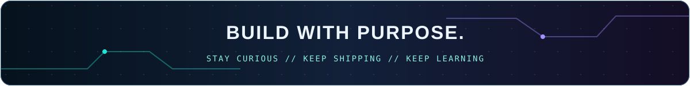

<!--
  CIANIUM // PROFILE COMMAND CENTER
  Custom artwork in assets/ — original SVGs inspired by the overall visual ambition
  of Jenesyx/pretty-github; no template artwork or personal data copied.
  Social profile links are grounded in the existing personal portfolio source.
-->

 

  

  

---

## `01 /` WHO I AM

I'm **Kian Khayat**, a student developer who enjoys taking ideas from a blank page to a working prototype. I'm especially interested in **software engineering, product architecture, automation, AI and cybersecurity**.

I like understanding what happens *behind* an interface: data flow, permissions, integration boundaries, deployment, testing and the engineering decisions that make a product more dependable.

> **My approach:** Learn deeply. Build deliberately. Test the assumptions. Improve the system.

`BUILDING:` Real-world web product prototypes &nbsp;·&nbsp; `LEARNING:` Python, security, backend, system design &nbsp;·&nbsp; `EXPLORING:` AI and intelligent education

## `02 /` ENGINEERING TOOLKIT

 

Technologies I've worked with or am actively learning — not a claim of mastery in every tool.

<table>
<tr>
<td width="33%" valign="top">

**`FRONTEND /`**

TypeScript · JavaScript

React · Astro · Vite

HTML · CSS · Responsive UI

</td>
<td width="33%" valign="top">

**`BACKEND & DATA /`**

Python · APIs

PostgreSQL · Supabase

Authentication · Data modeling

</td>
<td width="33%" valign="top">

**`ENGINEERING /`**

Git · GitHub · Linux

Testing · CI · Deployment

Security fundamentals

</td>
</tr>
</table>

## `03 /` FEATURED BUILDS

SELECTED PUBLIC REPOSITORIES / ACTUAL SOURCE CODE / CLEAR DEVELOPMENT STATUS

<table>
<tr>
<td width="50%" valign="top">
<h3>01 — German Library</h3>
A mobile-first German-learning resource library with CEFR navigation, content tools and an evolving article platform.

<b>JavaScript · Supabase · Language Learning</b>

  

</td>
<td width="50%" valign="top">
<h3>02 — Online Menu</h3>
A multilingual restaurant-menu and operations platform evolving toward QR ordering, administration and POS workflows.

<b>JavaScript · API Design · Restaurant Tech</b>

  

</td>
</tr>
<tr>
<td width="50%" valign="top">
<h3>03 — Developer Portfolio</h3>
My multilingual Astro portfolio, with English, German and Persian content, automated checks and accessibility-focused UI.

<b>Astro · TypeScript · Playwright</b>

  

</td>
<td width="50%" valign="top">
<h3>04 — CianOS / Life RPG</h3>
A browser-based gamification prototype built around quests, XP, learning progress and self-improvement mechanics.

<b>Vanilla JavaScript · Gamification</b>

  

</td>
</tr>
<tr>
<td width="50%" valign="top">
<h3>05 — BODRIN Coffee</h3>
A visual, 3D-oriented coffee storefront prototype combining UI exploration with interactive product presentation.

<b>React · TypeScript · Three.js</b>

  

</td>
<td width="50%" valign="top">
<h3>06 — Nightwalker Hub</h3>
A Persian, right-to-left creator website with streaming links, live-status experiments and responsive design.

<b>HTML · CSS · JavaScript · RTL</b>

  

</td>
</tr>
</table>

**Build status matters.** Public source, a successful CI run and a published demo are different things. Some integrations, authentication, payments and external APIs still require environment-specific validation; these cards are not production-readiness claims.

<b>⚙️ PRIVATE LABS // Explore what I'm working toward</b>

 

- **Barber-Shop** — an internal-development SaaS prototype for booking, shop management and storefront workflows.
- **HiTech Learn** — a multilingual EdTech platform foundation, with M0 architecture and learning-product research.
- **Coworker** — a planned private operations workspace for development and marketing teams.

These repositories are private. They are described at a high level, without offering inaccessible Source links or suggesting that unreleased modules are working products.

## `04 /` CURRENT SIGNAL

<table>
<tr>
<td width="50%" valign="top">

**NOW BUILDING**

- Safer, more reliable web applications
- Product architectures with clear responsibilities
- Learning tools that make complex ideas easier

</td>
<td width="50%" valign="top">

**NOW EXPLORING**

- Python & backend fundamentals
- Applied security & threat modeling
- AI systems and intelligent automation
- German & English communication

</td>
</tr>
</table>

## `05 /` GITHUB ACTIVITY

Activity graph is a third-party visualization of public GitHub data and may occasionally be unavailable.

---

  

 

Crafted for <a href="https://github.com/cianium">cianium</a> · Original SVG identity · Visual inspiration: <a href="https://github.com/Jenesyx/pretty-github">Pretty GitHub</a>

